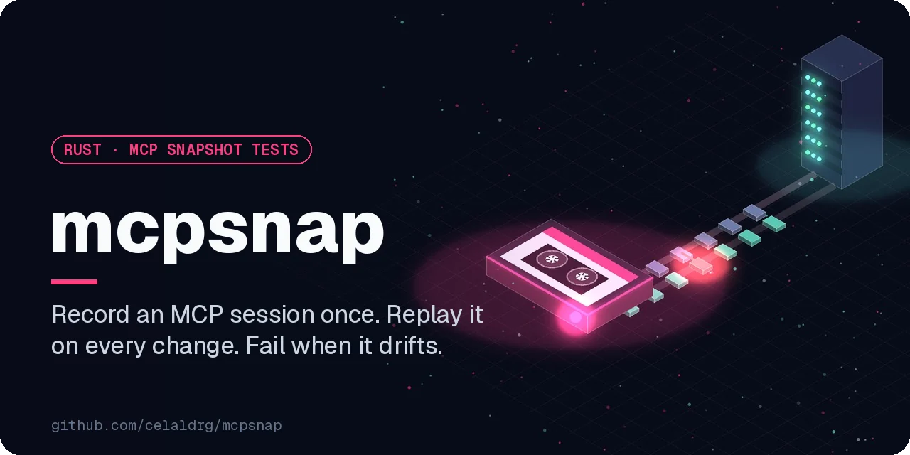
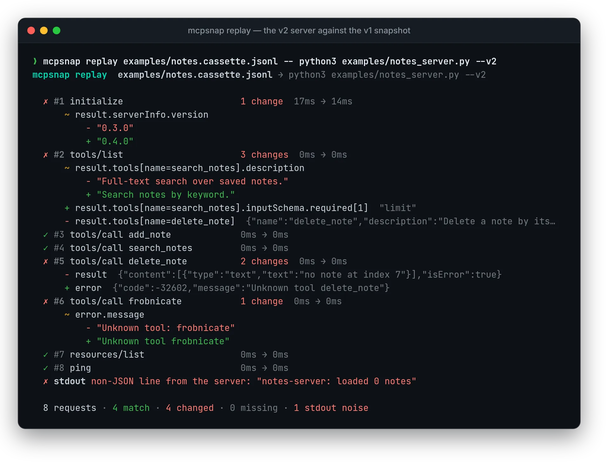
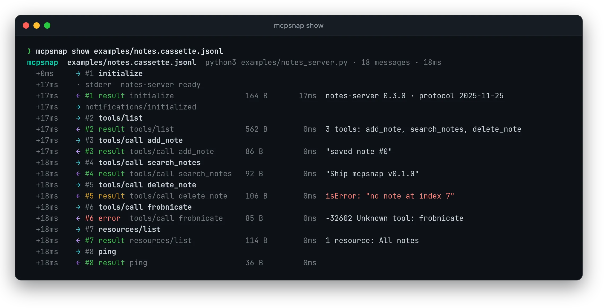

<p align="center">
  
</p>

<h3 align="center">Record an MCP session once. Replay it on every change. Fail when it drifts.</h3>

<p align="center">
  <a href="https://github.com/celaldrg/mcpsnap/actions/workflows/ci.yml"></a>
  <a href="https://github.com/celaldrg/mcpsnap/releases"></a>
  <a href="LICENSE"></a>
  
  
</p>

## Why

An MCP server's real API is not its source code, it is what goes over the wire: the tool names, descriptions and input schemas the model reads in `tools/list`, the shape of every `tools/call` result, the error codes and messages. Change any of those by accident and nothing fails. Unit tests still pass, the server still starts, and agents quietly start calling tools wrong.

The usual suspects:

- a reworded tool **description** (the model's only documentation) or a parameter that became **required**
- a tool that was **renamed or removed** in a refactor
- a result that turned into a JSON-RPC **error**, or an error message clients were matching on
- a stray `print()` that writes to **stdout** and corrupts the stdio stream for strict clients

`mcpsnap` turns a real session into a regression test. Put it in front of your server once, use your server from any client (Claude Desktop, Cursor, an Inspector, a script), and it writes everything that goes over stdio to a small JSONL **cassette**. Commit the cassette. In CI, `mcpsnap replay` starts the server again, sends the same client messages, and diffs every response against the snapshot, path by path.

- One static binary, **zero dependencies**, written in Rust. Works with servers in any language.
- Tools, prompts and resources are matched **by name**, not by position, so diffs read like `result.tools[name=search_notes].inputSchema.required[1]`.
- Answers **server-to-client requests** (`roots/list`, `sampling/createMessage`, `elicitation/create`) from the recording, so interactive sessions replay too.
- `--ignore` for volatile fields (`result.serverInfo.version`, `**.timestamp`), `--update` to accept a new snapshot, `--json` for CI.
- `show` prints a cassette as a timeline, `stats` reports per-method latency, payload size, tool-definition token cost and protocol issues.

<p align="center">
  
  <br><sub>Real output: the example server's "next release" replayed against the snapshot of the current one.</sub>
</p>

## Install

```sh
cargo install --git https://github.com/celaldrg/mcpsnap
```

Or grab a prebuilt binary (Linux x86_64/arm64 static, macOS arm64/x86_64, Windows x86_64) from the [latest release](https://github.com/celaldrg/mcpsnap/releases/latest).

## Usage

```text
mcpsnap record [-o FILE] [--quiet-stderr] -- <server command...>
mcpsnap replay FILE [--ignore PATH]... [--timeout MS] [--update] [--json] [-- <server command...>]
mcpsnap show FILE [--full]
mcpsnap stats FILE [--json]
```

| Command | What it does |
| --- | --- |
| `record` | Runs the server behind a transparent stdio proxy. Client and server talk normally; every line in both directions (and the server's stderr) is appended to the cassette, default `mcpsnap.cassette.jsonl`. |
| `replay` | Starts the server again (the recorded command, or the one after `--`), sends the recorded client traffic in order and diffs each response. Exit `1` on any change, missing response or non-JSON stdout. |
| `show` | Prints a cassette as a readable timeline with sizes, latencies and one-line summaries. |
| `stats` | Calls, errors, p50/max latency and response size per method, plus protocol issues: non-JSON on stdout, requests never answered, reused ids, missing `"jsonrpc": "2.0"`. |

Exit codes: `0` ok, `1` drift or protocol issues, `2` usage or I/O error.

### Recording from a real client

Prefix the server command in your client's config with `mcpsnap record -o <file> --`:

```json
{
  "mcpServers": {
    "notes": {
      "command": "mcpsnap",
      "args": ["record", "-o", "/path/to/repo/tests/notes.cassette.jsonl", "--",
               "python3", "/path/to/repo/server.py"]
    }
  }
}
```

Use the server as usual, then remove the prefix. Every message is flushed as it happens, so a session that ends with the client killing the server is still a valid cassette.

### Ignore paths

`--ignore` takes dotted paths into each response (`id` and `jsonrpc` are never compared). `*` matches one segment, `**` any depth, and elements of arrays of named objects can be addressed by name, index or `*`:

```sh
mcpsnap replay tests/notes.cassette.jsonl \
  --ignore result.serverInfo.version \
  --ignore '**._meta' \
  --ignore 'result.tools[name=search_notes].description'
```

## Example

The repository ships a small stdio server, [`examples/notes_server.py`](examples/notes_server.py), and a 40-line client that plays [`examples/client-session.jsonl`](examples/client-session.jsonl) against it. Run with `--v2`, the server becomes "the next release": one description reworded, a new required argument, a tool removed, an error message changed and a debug `print()` left in.

<p align="center">
  
</p>

Recording a session and replaying it against the same server:

```console
$ python3 examples/demo_client.py -- mcpsnap record -o examples/notes.cassette.jsonl -- python3 examples/notes_server.py
$ mcpsnap replay examples/notes.cassette.jsonl
mcpsnap replay  examples/notes.cassette.jsonl → python3 examples/notes_server.py

  ✓ #1 initialize                      17ms → 15ms
  ✓ #2 tools/list                      0ms → 1ms
  ✓ #3 tools/call add_note             0ms → 0ms
  ✓ #4 tools/call search_notes         0ms → 0ms
  ✓ #5 tools/call delete_note          0ms → 0ms
  ✓ #6 tools/call frobnicate           0ms → 0ms
  ✓ #7 resources/list                  0ms → 0ms
  ✓ #8 ping                            0ms → 0ms

  8 requests · 8 match · 0 changed · 0 missing
```

Replaying the same cassette against `--v2`:

```console
$ mcpsnap replay examples/notes.cassette.jsonl --ignore result.serverInfo.version -- python3 examples/notes_server.py --v2
mcpsnap replay  examples/notes.cassette.jsonl → python3 examples/notes_server.py --v2

  ✓ #1 initialize                      17ms → 18ms
  ✗ #2 tools/list                      3 changes  0ms → 0ms
      ~ result.tools[name=search_notes].description
          - "Full-text search over saved notes."
          + "Search notes by keyword."
      + result.tools[name=search_notes].inputSchema.required[1]  "limit"
      - result.tools[name=delete_note]  {"name":"delete_note","description":"Delete a note by its…
  ✓ #3 tools/call add_note             0ms → 0ms
  ✓ #4 tools/call search_notes         0ms → 0ms
  ✗ #5 tools/call delete_note          2 changes  0ms → 1ms
      - result  {"content":[{"type":"text","text":"no note at index 7"}],"isError":true}
      + error  {"code":-32602,"message":"Unknown tool delete_note"}
  ✗ #6 tools/call frobnicate           1 change  0ms → 0ms
      ~ error.message
          - "Unknown tool: frobnicate"
          + "Unknown tool frobnicate"
  ✓ #7 resources/list                  0ms → 0ms
  ✓ #8 ping                            0ms → 0ms
  ✗ stdout non-JSON line from the server: "notes-server: loaded 0 notes"

  8 requests · 5 match · 3 changed · 0 missing · 1 stdout noise
```

If the change was intended, `--update` rewrites the cassette with the new responses.

`stats` on a recording of the v2 server:

```console
$ mcpsnap stats examples/notes-v2.cassette.jsonl
mcpsnap stats  examples/notes-v2.cassette.jsonl  19 messages · 1 notifications · 1 stderr lines · 16ms

  method                  calls  errors  p50      max      response size
  initialize              1      0       15ms     15ms     164 B
  ping                    1      0       0ms      0ms      36 B
  resources/list          1      0       0ms      0ms      114 B
  tools/call              4      2       0ms      0ms      347 B
  tools/list              1      0       0ms      0ms      398 B  ≈99 tokens of tool definitions

  ✗ non-JSON line on server stdout at +15ms (strict clients drop the connection): "notes-server: loaded 0 notes"
```

<p align="center">
  
  <br><sub>Real output: <code>mcpsnap show examples/notes.cassette.jsonl</code>.</sub>
</p>

## In CI

```yaml
- run: cargo install --git https://github.com/celaldrg/mcpsnap
- run: mcpsnap replay tests/notes.cassette.jsonl --ignore result.serverInfo.version
```

Keep one cassette per scenario (`tests/snapshots/*.jsonl`) and loop over them. `--json` prints a single object with per-request outcomes and every change (`op`, `path`, `old`, `new`) for bots that comment on pull requests.

## Cassette format

One JSON object per line, easy to read, grep and review in a pull request:

```text
{"mcpsnap":1,"cmd":["python3","examples/notes_server.py"],"recorded":"2026-11-20T10:00:50Z"}
{"t":0,"dir":"c2s","msg":{"jsonrpc":"2.0","id":1,"method":"initialize","params":{...}}}
{"t":17,"dir":"err","line":"notes-server ready"}
{"t":17,"dir":"s2c","msg":{"jsonrpc":"2.0","id":1,"result":{...}}}
{"t":18,"dir":"s2c","raw":"notes-server: loaded 0 notes"}
```

`t` is milliseconds since the server started; `dir` is `c2s` (client to server), `s2c` (server to client) or `err` (stderr); stdout lines that are not JSON are kept as `raw` so they can be reported. You can also write cassettes by hand: only the `c2s` messages and the `s2c` responses are needed for `replay`.

## Scope and limits

- stdio transport only (newline-delimited JSON-RPC, as in the MCP spec). Streamable HTTP is not proxied.
- Messages are replayed in recorded order, one request at a time. Responses are compared structurally (numbers by value, object key order ignored); array order matters unless the elements are named objects.
- Tool results that depend on time, randomness or external services need `--ignore` paths, or a test mode in the server.

## Credits

The record/replay idea comes from HTTP "cassette" libraries such as Ruby's VCR and Python's vcrpy, and from snapshot testing as popularised by Jest. `mcpsnap` is an independent implementation for the Model Context Protocol; all code here was written from scratch.

## License

[MIT](LICENSE) © Celalettin Durğaç
